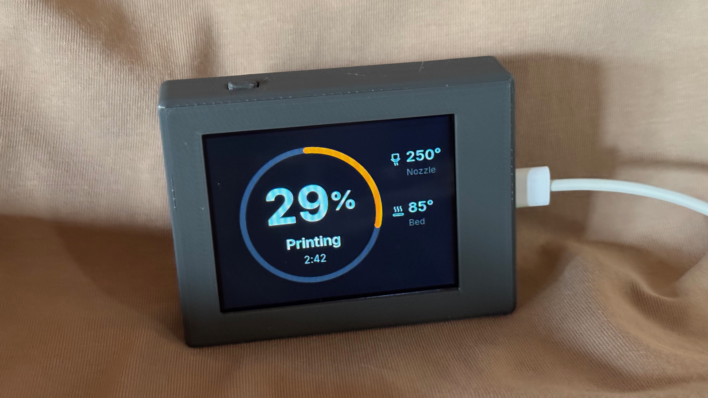
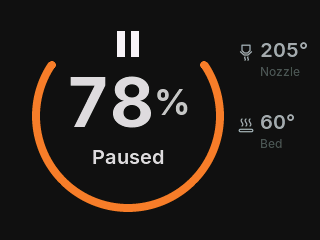
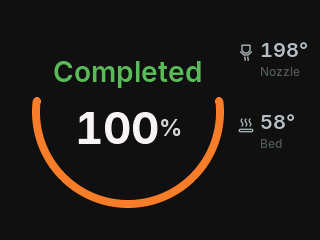
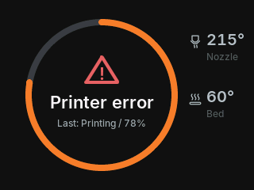

<!-- SPDX-FileCopyrightText: 2026 Mykola Fiantsev -->
<!-- SPDX-License-Identifier: CC-BY-4.0 -->

# Prusa Remote Display

Your print, at a glance.

A small screen for your desk that shows what your printer is doing, how far
the print has progressed and how much time is left. No need to reach for your
phone or walk over to the printer.

It reads status directly from your printer over home Wi-Fi using PrusaLink.
There is no cloud account, subscription or separate server. It monitors one
printer and never sends printer-control commands.

## Build your display

1. **Get the parts.** Use the [Waveshare ESP32-S3-LCD-2.8](https://www.waveshare.com/product/mcu-tools/development-boards/esp32-s3-touch-lcd-2.8.htm),
   choosing **Without Touch Function**. You can buy from any seller; the exact
   **non-touch** board matters. Add a USB data cable, USB power supply and the
   fasteners in the [parts and cost guide](docs/parts-and-cost.md).
2. **Print and assemble the case.** Follow the [printing](enclosure/printing.md)
   and [assembly](enclosure/assembly.md) guides. The case needs no soldering,
   threaded inserts or glue.
   [Case files on Printables](https://www.printables.com/model/1901185).
3. **Install and connect.** Install the firmware in your browser using a
   computer and a USB data cable. Then enter your Wi-Fi and PrusaLink details
   on the display's local setup page. You do not need to compile firmware.

Use Chrome or Edge (Safari and Firefox are not supported).

**[Build and set up your display →](docs/get-started.md)**

The main purchase is just the Waveshare board, at about US$20–26.
If you buy the other materials new too (filament, a cable, a USB charger and screws), budget about US$40–50 in total for one build, before shipping and tax.
See the [parts and cost breakdown](docs/parts-and-cost.md).

## What you will see

Print progress and time remaining take centre stage, with nozzle and bed
temperatures alongside them. The display follows preparation, printing,
pauses and completion. It also tells you when the printer needs attention or
the connection is lost.

| Paused | Completed | Printer error |
| :---: | :---: | :---: |
|  |  |  |

These are software-rendered screen examples, not photographs of the LCD.
[Image sources and attribution](assets/images/README.md).

The completed screen stays bright briefly, then dimly visible
for twenty minutes unless a new printer state replaces it. Hold the display's
button for two seconds and release to open settings.

## What you need

- The **Waveshare ESP32-S3-LCD-2.8, non-touch** board, the tested configuration.
  The touch version has not been tested with this firmware or enclosure;
  compatibility has not been established. Other ESP32 boards remain outside
  the supported configuration.
- A **Prusa CORE One** with local PrusaLink access. MK4S and MINI compatibility
  has not been established.
- **2.4 GHz Wi-Fi** that lets the display reach the printer on your local network.
- A computer running **Chrome or Edge** for the initial USB installation.

Normal monitoring stays on your local network. When online, the display also
checks GitHub roughly once a day for firmware updates; it installs nothing
unless you choose to update.

## Help and updates

Start with [installation, updates and recovery](docs/installation-and-recovery.md)
if you need to change settings or something goes wrong. For feedback and fixes,
see [Contributing](CONTRIBUTING.md). You can follow releases through GitHub's
**Watch → Custom → Releases**.

## For developers

The [development setup](docs/development/macos-setup.md) covers the pinned tools
and build commands. See the [architecture map](docs/development/architecture.md),
[UI rendering guide](docs/development/ui-rendering.md) and
[release validation notes](docs/release-validation.md) for deeper work.
See [editable enclosure sources](enclosure/source/README.md) for case changes.

## Project and licences

This is an independent community project by Mykola Fiantsev, not affiliated
with or endorsed by Prusa Research.

- Software: [GPL-3.0-only](LICENSE).
- Hardware designs: [CERN-OHL-S-2.0](LICENSE-hardware).
- Documentation and original photos: [CC-BY-4.0](LICENSE-documentation).
- Project name, logo and designated brand assets: all rights reserved.

See [Licensing](LICENSING.md) for scope and contribution terms, and
[third-party notices](THIRD_PARTY_NOTICES.md) for included dependencies.
