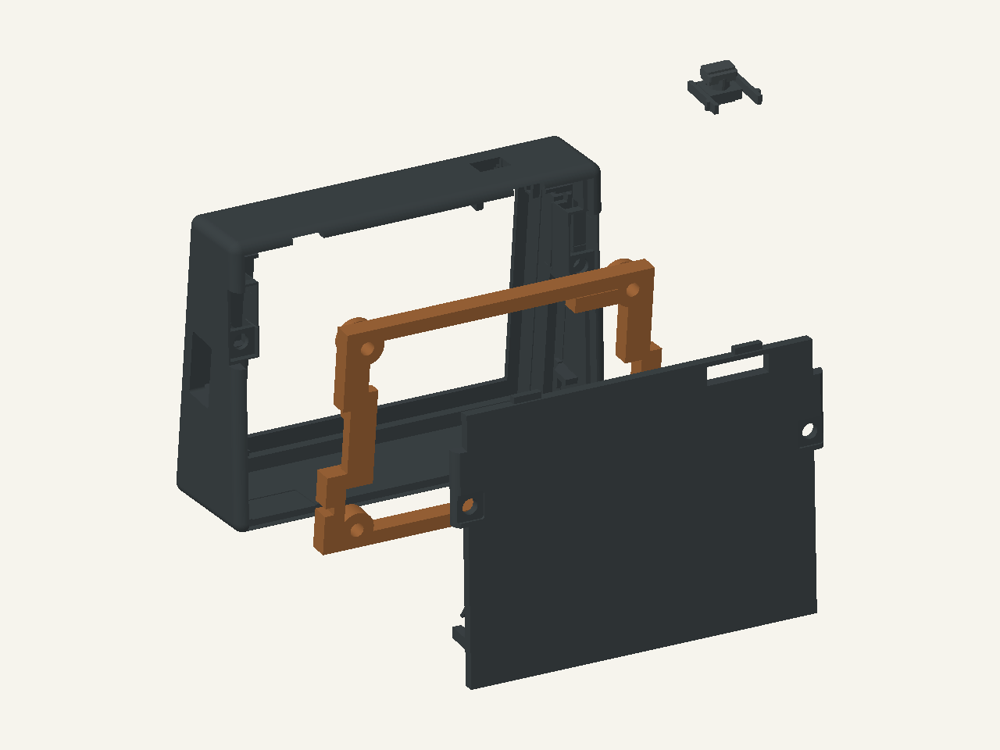

<!-- SPDX-FileCopyrightText: 2026 Mykola Fiantsev -->
<!-- SPDX-License-Identifier: CC-BY-4.0 -->

# Enclosure cleanup and assembly

This guide matches the [set of four print groups](printing.md).
The square nuts remain; there are no printed nut keepers.
The project author confirmed on 3 November 2026 that the assembled enclosure
shown in the photograph is this version. Only the two printed nut keepers
were removed from the plate; the remaining geometry is unchanged.

Disconnect USB and any other board power throughout these steps.

*CAD concept illustration of the matching printed parts, without the board or
fasteners. Offsets explain the parts, not an insertion path, collision clearance
or physically verified fit. The amber frame is the carrier.*

**Figure key — look from the rear of the shell:**

| Position in this picture | What you are looking at |
| --- | --- |
| Large dark frame at the left/back | **Shell.** Its open rear faces the separated carrier and cover; the screen will face away from you through the front window. The button opening is in the top rim. |
| Amber open frame in the middle | **Carrier.** The board attaches to its four mounting seats. The two upper seats include the round locating hole and the elongated slot. |
| Solid dark panel at the lower right | **Rear cover.** Its two short upper tongues are the projections along its top long edge; these engage before the lower edge closes. |
| Small dark assembly at the upper right | **Cassette and captive button.** It belongs inside the shell's top button opening; its displaced position here only makes it easier to identify. |

Use the shell's open rear as your access side. The **loading windows** are the
rear entries to the two nut channels on the inner side walls, beside the cover
screw positions; look inside the empty shell to find both before adding the
board. The **upper keys** are the small locating features just below the top
rim inside the shell; the carrier/module lifts beneath them in step 5. These
small internal features can be partly obscured in this overall view. The
**tongues** belong to the cover, while the **round hole and elongated slot**
belong to the carrier's upper mounting seats. Do not confuse them with the
cover's USB opening or screw holes.

[Illustration sources and attribution](../docs/media/README.md).

## Prepare parts and fasteners

You need the main shell, rear cover, carrier frame and captive-button cassette,
a **Waveshare ESP32-S3-LCD-2.8 non-touch** board, fine pliers for cleanup and
**1.5 mm and 2 mm Allen keys** for the M2.5 and M3 ISO 7380-1 screws respectively
([tool references](../docs/parts-and-cost.md#tools)).

| Fastener | Quantity | Where it goes |
| --- | ---: | --- |
| M2.5×6, ISO 7380-1, low button head | 4 | Through the carrier into the module's four stock metal threaded posts |
| M3×8, ISO 7380-1, button head | 2 | Through the rear cover into the shell's square nuts |
| Thin square M3 nut, Prusa M3nS / DIN 562 type | 2 | In the shell's two nut channels |

Measure the 6 and 8 mm lengths from the underside of the head to the screw tip.
Do not add washers. Do not substitute longer M2.5×8 or M2.5×10 board screws:
these screw into the stock metal posts, with no additional nuts there.
Ordinary hex M3 nuts do not replace the thin square nuts. No glue is needed.

## 1. Clean the printed parts

Remove **three flat rectangular pads** from the cassette: one beneath the
button cap and two beneath its skirts. These are separate temporary bodies.
Grip an accessible edge with fine pliers and withdraw them through the cassette's
open front, away from the long rear legs. Do not pull along the button's travel
or lever against its thin stem or guide.

Do not remove the button from the cassette. Its cap, stem, nose, two skirts
and the two long hooked legs are functional parts; do not cut them off.
After cleanup, the button stays captive in the guide and should move freely.

Remove brim, stringing and loose strands from the other parts; remove any
supports you added. Keep the internal shelves and ribs, upper catches, board
supports and flexible cover tongues. Remove only loose strands from the M3
holes and nut channels; do not drill or enlarge the seats before a trial fit.
If a pad has fused to the part or anything cracks, do not force it apart.

*CAD concept illustration: pads are displaced for recognition; orange marks
only those three temporary bodies. Keep every other cassette and button part.
The removal direction is described above; the picture is not a removal-path
or force demonstration. Do not force stuck parts.*

**Cleanup figure key:** the wide orange rectangle at the **upper left** is the
**cap pad**. The narrow orange **strip near the centre** is the **upper-skirt
pad**, seen edge-on; it is a whole third pad, not a loose strand. The wide
orange rectangle at the **lower left** is the **lower-skirt pad**. The dark
assembly at the **upper right** is the cassette with its captive button —
keep it intact. These displaced orange pieces do not show their removal path;
on the printed cassette they lie beneath the cap and two skirts as described
above. Remove three pads, not any part of the dark guide or hooked legs.

## 2. Fit the cassette in the empty shell

Install the cassette **from inside, before the board**, through the open rear.
The button cap faces the outside opening in the shell's top rim (figure key
above); the long legs face the cover.
Press the moving button slightly into the cassette and squeeze the rear ends
of both legs inward. Bring the cassette under its seat, lift it into the guides,
slide it forward toward the shell's front and release the legs. Both hooks
must engage.

Do not force the entire cassette through the exterior button opening.
Check that it moves freely without the board; without the BOOT switch,
the button does not have to spring outward on its own.

## 3. Place the square nuts

Insert two nuts from the rear through the loading windows and lower them into
place, using the two loading windows described below the figure key. Align the
nuts' threaded holes with the rear-cover screw holes.
There are no printed keepers: carefully hold and align the nuts until the
cover screws engage. If a nut shifts during the following steps, reposition
it before fitting the cover. Do not use glue or insert the M3 screws yet.

## 4. Screw the board to the carrier

Do this outside the shell. The frame sits behind the board; the module's four
metal post ends rest on the frame's four seats. The upper posts locate in the
round locating hole and elongated slot at the carrier's two upper mounting
seats (amber frame in the figure key). Start all four M2.5×6 screws by hand for 1–2
turns, then tighten diagonally until the heads just seat. Keep the board flat.
Do not force a screw that becomes tight before its head seats.

## 5. Insert the module in the shell

Face the screen toward the front window and the USB connector toward its cutout.
Before insertion, move the button outward and do not hold it pressed.
Insert the module and carrier from the rear, slightly below their final position;
lift under the upper keys just inside the shell's top rim (described below the figure key), then
gently slide forward onto the seats. Hold the
frame and module edges; do not press the LCD or use the USB connector as a lever.

## 6. Close the shell

Check both nuts. First engage the cover's two upper tongues beneath the shell's
upper edge, then bring in the lower edge. The cover must sit evenly before
tightening; do not use the screws to pull an incorrectly seated gap closed.

Hold and align the nuts as needed, start both M3×8 screws, then tighten them
alternately in small movements until lightly clamped. If a screw does not
engage, remove the cover, reposition and align the nut, refit the cover upper
tongues first and try again. Access the nuts only with the cover removed;
do not force a screw. The heads need not sit flush with the cover; do not try
to sink them by tightening harder.

## 7. Check the mechanism without power

The board must not rock or bend, and the cover must not sit skewed.
Gently press the button once to the first BOOT click, then release. The switch
must release, the button must move without binding and the cassette must stay
in place. If there is a hard stop before the click, do not press harder.
This checks the mechanism, not electrical operation.

Continue with firmware installation and setup in the [build guide](../docs/get-started.md).
